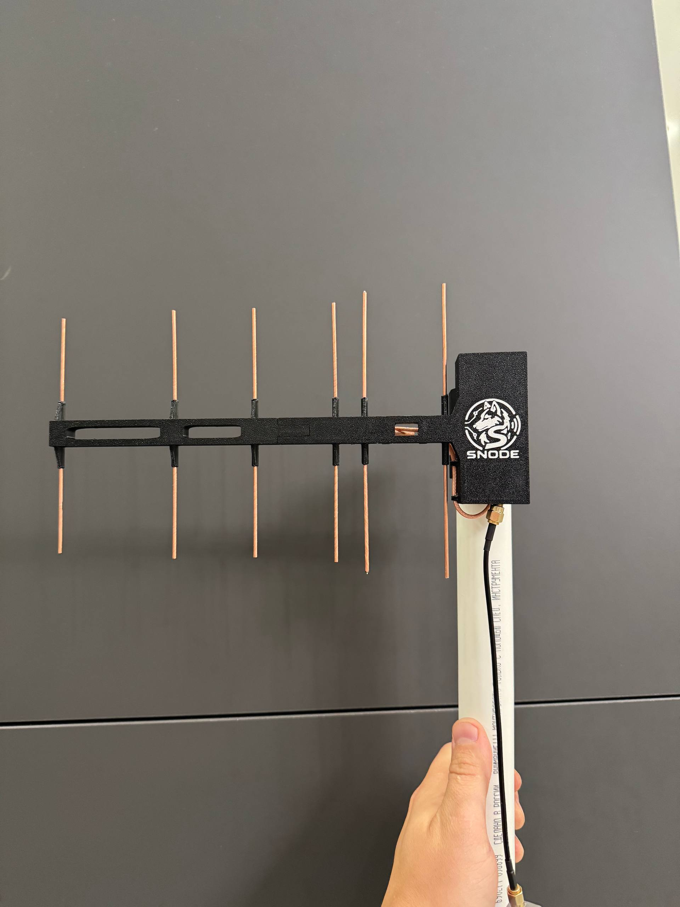
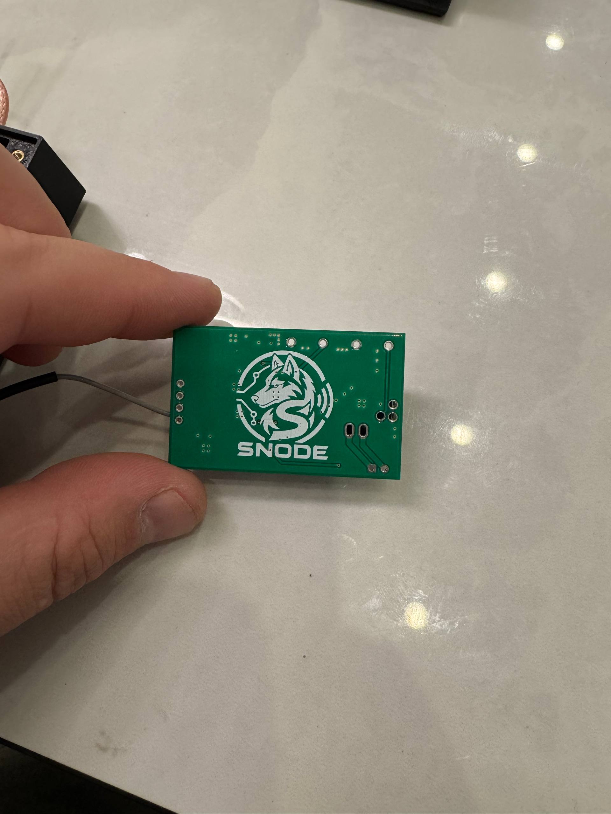
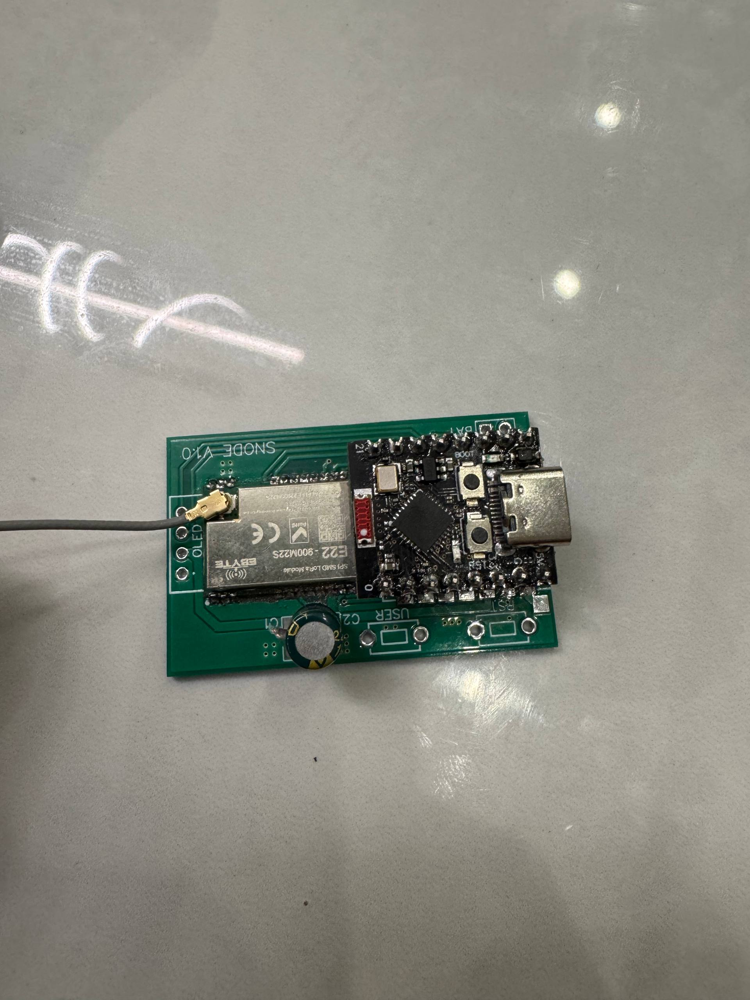

# SNode_rep: ESP32-C3 Super Mini + E22-900M22S

Рабочая сборка MeshCore-репитера на `ESP32-C3 Super Mini` и модуле
`Ebyte E22-900M22S` (SX1262, 22 dBm, TCXO 1,8 В).

> Эта инструкция предназначена именно для **E22-900M22S** в корпусе с
> 22 контактами. Другие варианты радиомодуля этой прошивкой не поддерживаются.

## Параметры готовой прошивки

| Параметр | Значение |
| --- | --- |
| Версия MeshCore | 1.17.1 (`repeater-v1.17.1`) |
| Имя репитера | `SNode_rep` |
| Частота | `869,050 МГц` |
| Полоса | `62,5 кГц` |
| Spreading Factor | `SF8` |
| Coding Rate | `CR 4/7` |
| Мощность передачи | `22 dBm` |
| Генератор E22 | TCXO `1,8 В`, управление через DIO3 внутри модуля |
| Приём | RX Boosted Gain включён |

Перед использованием проверьте допустимые частоты, мощность и ограничения по
времени передачи для вашего региона.

## Фотографии собранного устройства

Готовый узел с направленной антенной:



Обратная сторона платы:



Установленные E22-900M22S и ESP32-C3 Super Mini:



## Подключение через плату SNode V1.0

Контакты ESP32-C3 Super Mini должны попасть на следующие площадки платы:

| ESP32-C3 Super Mini | Площадка платы |
| ---: | --- |
| `5V` | `5V` |
| `GND` | `GND` |
| `3.3V` | `3.3V` |
| `GPIO4` | `MOSI` |
| `GPIO3` | `MISO` |
| `GPIO2` | `SCK` |
| `GPIO1` | `RXEN` |
| `GPIO0` | не подключать |
| `GPIO5` | `NRST` |
| `GPIO6` | `DIO1` |
| `GPIO7` | `BUSY` |
| `GPIO8` | `NSS` |
| `GPIO9` | `SDA`, оставить свободным |
| `GPIO10` | `SCL`, оставить свободным |
| `GPIO20` | `TXEN` |
| `GPIO21` | не подключать |

OLED в этой версии не устанавливается. GPIO9 и GPIO10 всё равно явно назначены
в прошивке системной I²C-шине, чтобы она не заняла GPIO8 (`NSS`) автоматически.

## Прямое подключение к E22-900M22S

| ESP32-C3 | Контакт E22 | Сигнал |
| ---: | ---: | --- |
| `GPIO8` | 19 | `NSS / CS` |
| `GPIO2` | 18 | `SCK` |
| `GPIO4` | 17 | `MOSI` |
| `GPIO3` | 16 | `MISO` |
| `GPIO5` | 15 | `NRST` |
| `GPIO7` | 14 | `BUSY` |
| `GPIO6` | 13 | `DIO1` |
| `GPIO20` | 7 | `TXEN` |
| `GPIO1` | 6 | `RXEN` |
| `3.3V` | 9 | `VCC` |
| `GND` | 10, 11, 12, 20 и 22 | `GND` |

- E22 pin 8 (`DIO2`) не подключается: `TXEN` и `RXEN` управляются отдельными GPIO.
- Отдельный провод к `DIO3` не нужен: он внутри E22 управляет TCXO 1,8 В.
- Центральная жила антенного кабеля подключается к pin 21 (`ANT`), экран — к
  ближайшему `GND`, pin 22.
- GPIO0 и GPIO21 остаются свободными.
- Для устойчивого уровня при загрузке рекомендуется подтяжка GPIO8 (`NSS`) к
  3,3 В резистором `10 кОм`.

## Питание и монтаж

1. Не включайте передатчик без антенны диапазона 868–869 МГц.
2. На VCC самого E22 подавайте только стабильные `3,3 В`. Прямые `5 В` повредят
   радиомодуль. Площадка `5V` на плате SNode предназначена для питания ESP32-C3,
   а не для прямого питания pin 9 E22.
3. Все земли E22 необходимо соединить с общей землёй платы. Одного случайного
   контакта корпуса недостаточно.
4. Возле E22 установите `100 нФ`, `10–47 мкФ` и электролит `220–470 мкФ` между
   3,3 В и GND.
5. SPI и управляющие провода делайте короткими. Антенный кабель держите дальше
   от USB и преобразователя питания.
6. Перед включением проверьте отсутствие короткого замыкания между 3,3 В и GND.

Нормальные ориентировочные уровни после загрузки: `NRST ≈ 3,3 В`, `NSS ≈ 3,3 В`,
`BUSY ≈ 0 В` в покое.

## Установка готовой прошивки

Файл:

[`firmware/meshcore_esp32c3_supermini_e22_m22s_repeater_snode_v1.17.1_tcxo_merged.bin`](firmware/meshcore_esp32c3_supermini_e22_m22s_repeater_snode_v1.17.1_tcxo_merged.bin)

### 1. Установите esptool

macOS или Linux:

```bash
python3 -m venv .venv-flash
source .venv-flash/bin/activate
python -m pip install "esptool>=4.8,<5"
```

Windows PowerShell:

```powershell
py -m venv .venv-flash
.\.venv-flash\Scripts\Activate.ps1
python -m pip install "esptool>=4.8,<5"
```

### 2. Найдите последовательный порт

macOS:

```bash
ls /dev/cu.usb*
```

Linux:

```bash
ls /dev/ttyACM* /dev/ttyUSB*
```

В Windows порт вида `COM5` указан в диспетчере устройств.

### 3. Прошейте ESP32-C3

macOS, пример:

```bash
python -m esptool --chip esp32c3 --port /dev/cu.usbmodemXXXX --baud 460800 write_flash 0x0 esp32-c3-supermini-e22-900m22s/firmware/meshcore_esp32c3_supermini_e22_m22s_repeater_snode_v1.17.1_tcxo_merged.bin
```

Windows, пример:

```powershell
python -m esptool --chip esp32c3 --port COM5 --baud 460800 write_flash 0x0 esp32-c3-supermini-e22-900m22s/firmware/meshcore_esp32c3_supermini_e22_m22s_repeater_snode_v1.17.1_tcxo_merged.bin
```

Если соединение не начинается, удерживайте `BOOT`, кратко нажмите `RESET`,
отпустите `RESET`, затем `BOOT` и повторите команду. Для обычного обновления
`erase_flash` не требуется: стирание удаляет идентификатор и настройки ноды.

## Первый запуск и удалённое управление

1. Перезагрузите плату и дождитесь объявления `SNode_rep` в MeshCore.
2. Репитер не появляется как отдельное BLE-устройство. Откройте его через
   LoRa-компаньон, который уже подключён к приложению MeshCore.
3. Начальный пароль администратора в этой сборке — `password`. После первого
   успешного входа замените его.
4. Проверьте совпадение параметров всех нод: `869,050 / 62,5 / SF8 / CR 4/7`.
5. Отправьте объявление с ретрансляцией 2–3 раза, делая паузу между отправками.
6. Затем выполните серию пингов сначала рядом с устройством, после чего вынесите
   репитер на штатное место и повторите проверку.

## Сборка из исходников

Нужны Git, Python 3 и PlatformIO CLI.

```bash
git clone --branch repeater-v1.17.1 --depth 1 https://github.com/meshcore-dev/MeshCore.git
cd MeshCore
cp -R /путь/к/meshtastic-m5stack-e22/esp32-c3-supermini-e22-900m22s/source-overlay/. .
pio run -e supermini_c3_e22_m22s_repeater_snode -t mergebin
```

Объединённый образ появится в каталоге
`.pio/build/supermini_c3_e22_m22s_repeater_snode/`. Overlay содержит окружение
PlatformIO, выбор аппаратного SPI `FSPI`, поддержку TXEN/RXEN, TCXO 1,8 В и
диагностику RSSI/SNR/ошибки частоты.

## Проверка контрольной суммы

Из каталога проекта:

```bash
cd esp32-c3-supermini-e22-900m22s/firmware
shasum -a 256 -c SHA256SUMS
```

Ожидаемый результат — `OK`.

## Если появляются timeout

Проверяйте по порядку:

1. Общую землю всех контактов E22 и ESP32-C3.
2. Питание E22 осциллографом или мультиметром во время передачи; просадка 3,3 В
   часто проявляется только при TX.
3. `BUSY`: в покое около 0 В. Постоянный высокий или промежуточный уровень
   указывает на ошибку монтажа или питания.
4. `NSS`: в покое около 3,3 В. Уровень около 2,7 В требует проверки пайки и
   подтяжки 10 кОм.
5. Наличие ответов `MISO` при обмене SPI.
6. Совпадение частоты, BW, SF и CR на всех нодах.
7. Антенну, кабель и SMA-разъём. Не передавайте без нагрузки 50 Ом.

Если рядом всё работает, а на улице связь пропадает, в первую очередь проверяйте
питание от power bank, общий GND, USB-кабель, герметичный корпус и антенный тракт.
